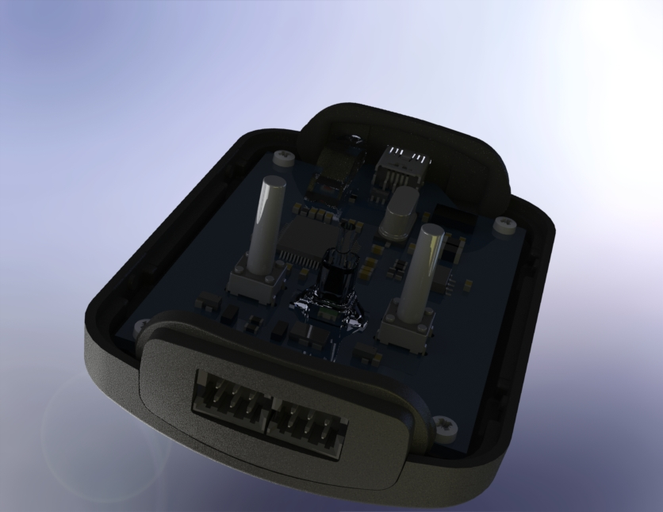
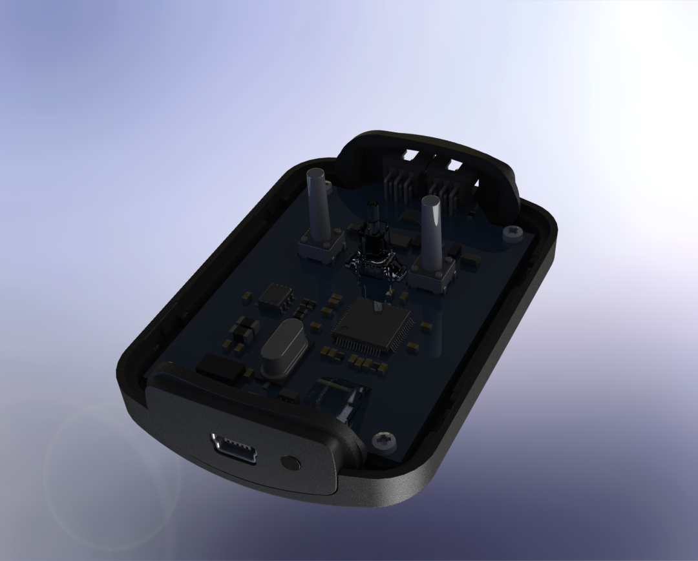
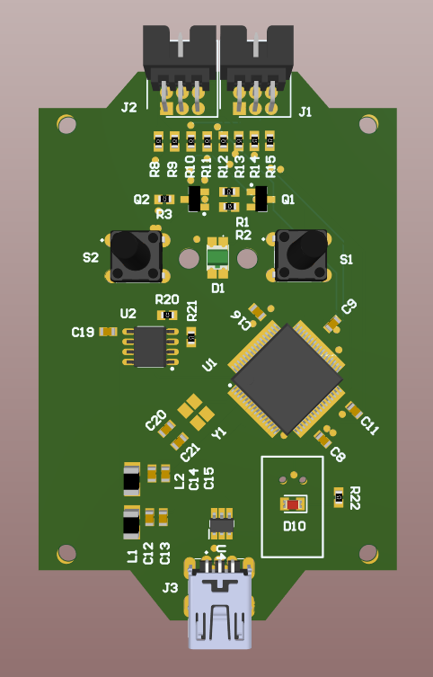
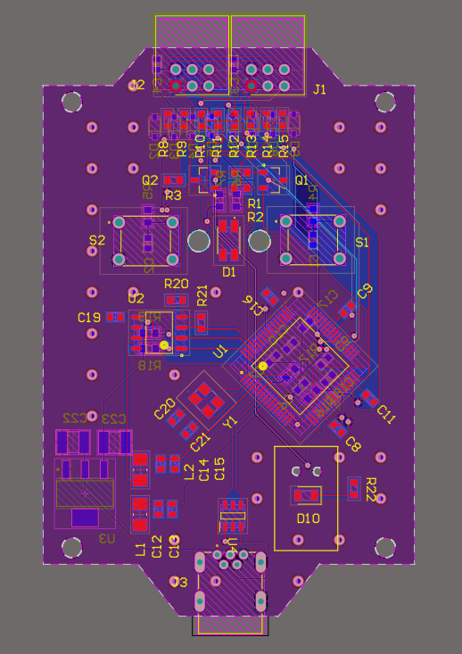

<p align="center">
  
</p>

<h1 align="center">FlashCraft</h1>

<p align="center">
  <b>USB programmer &amp; JTAG debugger for ESP32 and other embedded targets</b>
</p>

<p align="center">
  
  
</p>

---

## Overview

FlashCraft is a compact, open-hardware programmer/debugger built around the **FTDI FT2232HL** dual-channel USB bridge. One USB cable gives you:

- **Channel A – UART**: serial flashing and console, with automatic reset/boot-mode entry for ESP32 (DTR/RTS → EN/GPIO0).
- **Channel B – JTAG**: on-chip debugging (breakpoints, stepping, memory inspection) through OpenOCD/GDB.

The board fits in a **Hammond 1553A** handheld enclosure.

## Hardware

<p align="center">
  
  
</p>

| Block | Details |
|---|---|
| USB bridge | FTDI FT2232HL, dual channel (UART + MPSSE/JTAG) |
| USB | Mini-USB connector with ESD protection |
| Power | 5 V from USB → 3.3 V LDO (Torex) for logic and target I/O |
| Auto-program | Dual-transistor DTR/RTS circuit driving ESP `EN` and `GPIO0` |
| Buttons | Manual `EN` (reset) and `BOOT` (GPIO0) push buttons |
| Connectors | J1: 2×3 UART header (TXD, RXD, EN, GPIO0, 3V3, GND)<br>J2: 2×3 JTAG header (TCK, TDI, TDO, TMS, 3V3, GND) |
| Indicators | TX/RX activity LEDs, power LED |

### Schematics

| Sheet | PDF |
|---|---|
| USB & power | [USBandPOWER.pdf](docs/schematics/USBandPOWER.pdf) |
| FT2232 core | [FT2232Circuit.pdf](docs/schematics/FT2232Circuit.pdf) |
| Auto-program circuit | [AutoProgramCircuit.pdf](docs/schematics/AutoProgramCircuit.pdf) |
| UART & JTAG connectors | [ConnectorsCircuit.pdf](docs/schematics/ConnectorsCircuit.pdf) |

## Supported Targets

- **ESP32 family** – flashing over UART (`esptool.py`, Arduino, ESP-IDF) and JTAG debugging (OpenOCD).
- **Other JTAG targets** – any 3.3 V target supported by OpenOCD's FT2232 driver.

## Repository Layout

```
FlashCraft/
├── assets/                    Logo and icon
├── docs/
│   ├── datasheets/            Hammond 1553A enclosure drawings
│   ├── images/                PCB and enclosure renders
│   ├── schematics/            Schematic PDFs
│   └── drc-report.htm         Altium DRC report
└── hardware/
    ├── pcb/                   Altium Designer project (FlashCraft.PrjPcb)
    └── mechanical/
        ├── solidworks/        Enclosure and PCB assembly (SolidWorks)
        └── exports/           STEP / IGES / DXF / DWG exports
```

## Getting Started

1. Open `hardware/pcb/FlashCraft.PrjPcb` in Altium Designer.
2. Install the component library from [Gueni/Library – ALTIUM LIB](https://github.com/Gueni/Library/tree/master/ALTIUM%20LIB).
3. Generate fabrication outputs with `FlashCraft.OutJob`.

## Author

Mohamed Gueni
